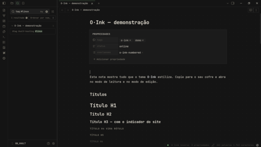

# O·Ink



Um tema para o [Obsidian](https://obsidian.md) que parece tinta em papel eletrônico.

O nome junta duas coisas: o **O** vem de Ownaka, o apelido que eu uso em tudo, e o **Ink** vem de tinta e das telas E-Ink. O visual nasceu do meu site, [ownaka.net](https://ownaka.net). Eu gostava tanto de abrir ele que quis ter a mesma sensação no lugar onde passo mais tempo escrevendo.

## A ideia

Eu queria um tema que não disputasse atenção com o que eu estou escrevendo. Então algumas regras guiaram tudo:

- **Pouca cor.** O texto é bege de papel envelhecido sobre um preto quase puro. Só existe uma cor de destaque, um verde apagado, e ela aparece apenas no que está ativo, concluído ou "online".
- **Linha em vez de sombra.** Cards, menus e blocos são separados por bordas de 1px, sem sombras nem cantos arredondados.
- **Uma fonte só.** Tudo usa a [Commit Mono](https://commitmono.com), da interface ao texto das notas. Ela já vem dentro do tema, então funciona sem instalar nada.
- **Detalhes que você sente mais do que vê.** Um fundo de pontinhos quase invisível, um flash rápido quando você clica num botão, como uma tela E-Ink trocando de página.

Tem também um modo claro, que inverte a lógica: papel envelhecido com tinta escura.

## Instalação

Baixe o `theme.css` e o `manifest.json`, crie a pasta `.obsidian/themes/O-Ink/` dentro do seu cofre e coloque os dois arquivos lá. Depois, em **Configurações → Aparência → Temas**, é só escolher **O-Ink**.

O nome oficial do tema é O-Ink, com hífen, porque o diretório de temas do Obsidian só aceita caracteres simples. O·Ink, com o ponto no meio, é só a forma estilizada.

Se você preferir pelo terminal:

```bash
git clone https://github.com/ownaka/obsidian-o-ink.git
cd obsidian-o-ink
python3 scripts/build.py --vault ~/caminho/do/seu/cofre
```

## O que muda na interface

O arquivo aberto no explorador ganha um `›` verde na frente, o mesmo indicador da navegação do meu site. A aba ativa tem uma linha verde fina no topo, e a barra de status mostra um quadradinho verde, como um sinal de "online".

A paleta de comandos, os menus e as janelas viram cards com borda, e o item selecionado é marcado por uma linha verde na lateral. Os botões piscam invertidos ao clicar. Interruptores, campos e dicas flutuantes seguem a mesma forma quadrada.

O gráfico de conexões e o Canvas usam as mesmas cores, e o Canvas ganha os mesmos pontinhos do fundo das notas.

O tema também foi ajustado para o Obsidian no Android, no celular e no tablet: a barra de ferramentas, as gavetas laterais e os menus seguem o mesmo visual, os itens são fáceis de tocar e o texto, as tabelas e os blocos de código cabem na tela.

## O que muda nas notas

Os títulos têm uma hierarquia clara. O H2 ganha uma linha fina embaixo e o H3 recebe o `›` verde. Do H4 em diante, os títulos viram rótulos pequenos em caixa alta, e o H4 aparece entre colchetes, `[ASSIM]`, do jeito que os cards do site são identificados.

As listas usam um pontinho quadrado verde no lugar da bolinha, um pouco mais apagado nos subníveis, e os números das listas numeradas também ficam em verde. Quem preferir pode voltar ao traço `–` pelo Style Settings. Negrito fica em branco, itálico em bege e o marca-texto em um verde translúcido. Links têm um sublinhado discreto, links para notas que ainda não existem ficam tracejados e links externos ganham uma setinha `↗`.

Blocos de código e tabelas têm borda, e o cabeçalho das tabelas segue o mesmo estilo de rótulo. As imagens recebem um filtro em preto e branco com um toque de sépia, que fica um pouco mais nítido quando você passa o mouse. As propriedades da nota aparecem como um card.

### Tarefas

Além do `[ ]` e do `[x]`, o tema reconhece outros marcadores, cada um com sua cor:

| Marcador | Uso |
| --- | --- |
| `[/]` | em andamento |
| `[-]` | cancelada |
| `[>]` | adiada |
| `[!]` | importante |
| `[?]` | dúvida |
| `[*]` | ideia |

### Callouts

Todos os callouts do Obsidian viram cards, com o título entre colchetes e cores ajustadas à paleta. Eu também criei três que fazem sentido pro jeito que eu escrevo:

```markdown
> [!card] Um card simples
> Igual aos blocos do site.

> [!terminal] Comandos
> docker compose up -d
> sudo systemctl restart jellyfin

> [!online] Status
> O selo verde de "online".
```

No `[!terminal]`, cada linha ganha um `$` na frente, como num prompt.

### Classes por nota

Algumas coisas fazem sentido só em certas notas. Para isso existem classes que você coloca nas propriedades:

```yaml
---
cssclasses:
  - o-ink-numbered
---
```

| Classe | O que faz |
| --- | --- |
| `o-ink-numbered` | numera os H2 como `[01]`, `[02]`... |
| `o-ink-wide` | deixa a nota mais larga |
| `o-ink-cards` | transforma cada H2 no topo de um card |
| `o-ink-center` | centraliza o título e os parágrafos |
| `o-ink-dots-off` | tira os pontinhos do fundo |
| `o-ink-eink-off` | mostra as imagens coloridas |

Na pasta [`docs`](docs/) tem uma nota usando quase tudo isso. Vale copiar pro seu cofre pra ver o tema funcionando de verdade.

## Personalização

Com o plugin [Style Settings](https://github.com/mgmeyers/obsidian-style-settings) instalado, aparece uma seção do O·Ink nas configurações. Por lá dá pra trocar a cor de destaque, o texto e o fundo, ajustar a intensidade e o espaçamento dos pontinhos, voltar para a fonte do sistema, numerar os títulos em todas as notas, voltar ao traço `–` nas listas e desligar o filtro das imagens, o flash dos botões ou o indicador da barra de status.

Se preferir não usar o plugin, a pasta [`snippets`](snippets/) tem dois exemplos que você pode copiar para `.obsidian/snippets/`: um troca as cores e os pontinhos, o outro usa uma fonte serifada no texto das notas mantendo a interface em Commit Mono.

## Desenvolvimento

O código do tema fica em `src/o-ink.css`. O `theme.css` é gerado a partir dele, com a fonte embutida. Para deixar o arquivo leve, o script embute só os caracteres usados em português e nos símbolos do tema, então precisa do [fonttools](https://github.com/fonttools/fonttools):

```bash
pip install fonttools brotli
python3 scripts/build.py
```

Passando `--vault` com o caminho do seu cofre, o script já instala a versão nova. Depois é só rodar o comando **Recarregar o app sem salvar** no Obsidian.

Se encontrar algo estranho ou tiver uma ideia, abre uma [issue](https://github.com/ownaka/obsidian-o-ink/issues). Prints mostrando o problema ajudam bastante.

## Créditos

A tipografia é a Commit Mono, criada por Eigil Nikolajsen e distribuída sob a SIL Open Font License 1.1.

Muito do cuidado que tentei colocar aqui veio de olhar temas como o [Primary](https://github.com/primary-theme/obsidian) e o [Minimal](https://github.com/kepano/obsidian-minimal), que mostram como um tema pode ser bem pensado nos detalhes.

## Licença

O código está sob a licença [MIT](LICENSE). A fonte segue a [SIL Open Font License 1.1](assets/fonts/OFL.txt).

---

**In English:** O·Ink is a minimal, E-Ink inspired theme for Obsidian, based on my website [ownaka.net](https://ownaka.net). It uses Commit Mono everywhere (bundled), a near-invisible dot grid, square corners, thin borders and a single green accent. It supports Style Settings, alternate checkboxes, three custom callouts (`card`, `terminal`, `online`) and per-note `cssclasses`.

Feito por João Prado ([ownaka](https://ownaka.net)).
